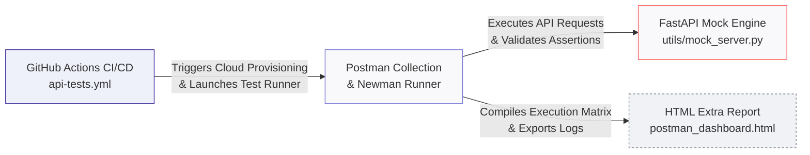
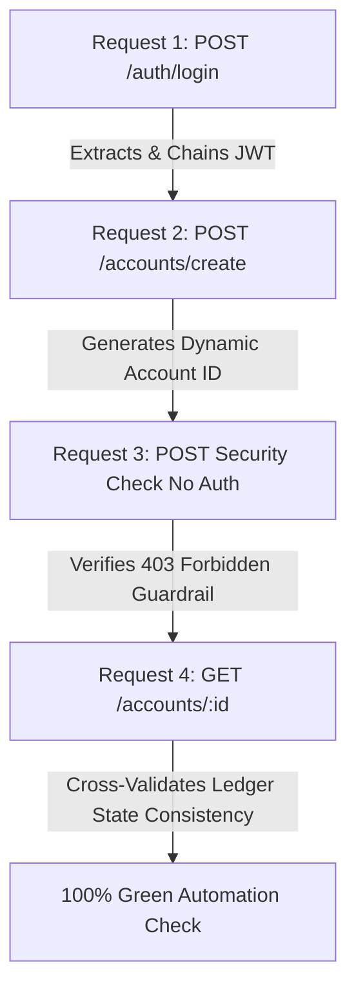

# 🏦 Enterprise FinTech Banking Core API Automation Framework

[](https://github.com)
[](https://postman.com)
[](https://tiangolo.com)

---

## 🎯 About The Project
This framework serves as a high-performance, enterprise-grade test automation suite built specifically for validating core financial ledger APIs. When handling secure banking engines, testing requires robust token management, strict schema enforcement, and absolute reliability. 

This project solves those requirements by launching a localized **FastAPI ledger engine mock server** and evaluating it against a containerized **Postman Collection pipeline**. The suite handles complex workflows—including dynamic JWT bearer token chaining, data isolation, and boundary security testing—in milliseconds, both locally and entirely in the cloud via CI/CD.

### 🛠️ Technology Stack Breakdown
* **Test Orchestration:** Postman App (Visual construction, environments, and JS assertion scripts)
* **Mock Backend Server:** FastAPI + Pydantic (High-performance, typing-enforced local ledger server engine)
* **CLI Runner Engine:** Newman CLI + HTML Extra Reporter (Terminal headless run execution and styled visual monitoring dashboards)
* **Continuous Integration:** GitHub Actions Pipelines (Automated cloud environment provisioning, background execution, and build artifact management)

---

## 🕹️ Interactive Navigation
* [🏗️ Core Architecture](#️-core-architecture)
* [📋 Framework Component Matrix](#-framework-component-matrix)
* [🚦 End-to-End API Pipeline Flow](#-end-to-end-api-pipeline-flow)
* [🚀 Local Command-Line Execution](#-local-command-line-execution)
* [⚙️ Cloud CI/CD Automation Matrix](#️-cloud-cicd-automation-matrix)

---

## 🏗️ Core Architecture



---

## 📋 Framework Component Matrix

| Component | Target Runtime / Port | Strategic Role |
| :--- | :--- | :--- |
| **FastAPI Mock Server** | Local Host (Port `8001`) / CI Background | Simulates secure core financial banking ledger engines with strict Pydantic parsing. |
| **Postman Testing Matrix** | Postman Client Suite (`FinTech_Core_Collection.json`) | Constructs visual requests, workflow scripts, environment maps, and Ajv schema assertions. |
| **Newman CLI Core Engine** | Node.js Headless System Environment | Executes the automated validation pipeline via command line locally or within CI workers. |
| **HTML Extra Reporter** | System Work Directory (`target/reports/`) | Aggregates runtime data into single-page, downloadable interactive visual analytics dashboards. |
| **GitHub Actions Pipeline** | Cloud Virtual Server (`ubuntu-latest`) | Orchestrates dynamic runtime installs, hooks environments, and handles test build artifacts. |

---

## 📂 Directory Blueprint

```text
fintech_api_framework/
├── .github/workflows/
│   └── api-tests.yml          # GitHub Actions Cloud CI Orchestrator
├── utils/
│   └── mock_server.py         # FastAPI Core Ledger Engine Mock
├── FinTech_Core_Collection.json# Automated Postman Testing Matrix Suite
├── FinTech_Staging_Env.json   # Dual-Cased Variable Environment Map
└── .gitignore                 # Reporting Dashboard & Cache Filter
```

---

## 🚦 End-to-End API Pipeline Flow

The framework executes 4 complex verification sequences sequentially:



### 🔍 Automated Testing Assertion Matrix
1. **`POST User Login`**: Verifies HTTP `200 OK`, response latency matches strict `<250ms` SLA benchmarks, and programmatically extracts session tokens.
2. **`POST Create Ledger Account`**: Generates a randomized numerical seed (`{{$randomInt}}`) deposit payload, asserts HTTP `201 Created`, and verifies strict corporate JSON Schema structural data models using Ajv.
3. **`POST Create Account - Missing Auth Token`**: Security boundary validation—asserts HTTP `403 Forbidden` and confirms clear access denied details.
4. **`GET Get Account Balance`**: Data ledger verification—cross-checks that the returned active balance tracking number matches the state values dynamically generated in step 2.

---

## 🚀 Local Command-Line Execution

### 1. Boot up the Core Ledger Engine Mock
```bash
pip install fastapi uvicorn pydantic
uvicorn utils.mock_server:app --reload --port 8001
```

### 2. Run the Automated Suite and Generate Reports
```bash
# Install Newman execution cores globally
npm install -g newman newman-reporter-htmlextra

# Trigger collection matrix runner and export visualization analytics
newman run FinTech_Core_Collection.json \
  -e FinTech_Staging_Env.json \
  -r cli,htmlextra \
  --reporter-htmlextra-export target/reports/postman_dashboard.html
```

### 3. Open the Compiled Interactive Visual Dashboard
```bash
open target/reports/postman_dashboard.html
```

---

## ⚙️ Cloud CI/CD Automation Matrix

This project is integrated with **GitHub Actions**. Every single code push or pull request instantly spins up an isolated `ubuntu-latest` virtual server container in the cloud which automatically:
* Installs system runtime engines (Python 3.13, Node.js 20).
* Launches your FastAPI server in background modes.
* Executes your Postman suite via Newman.
* Archives your visual reporting dashboards as downloadable build artifacts (`postman-test-dashboard`).
